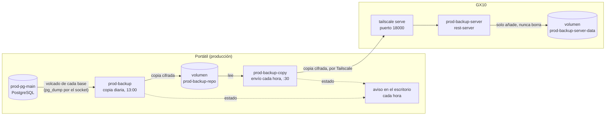
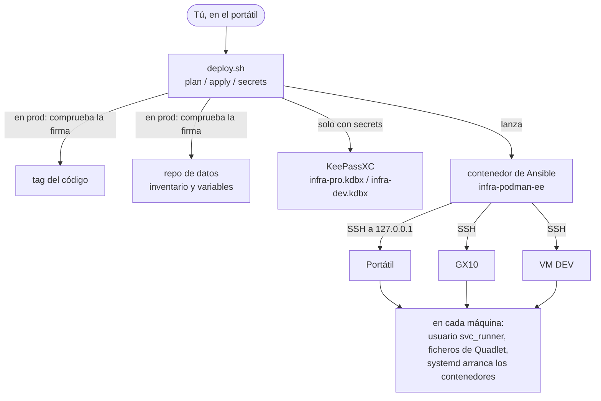

# Arquitectura

Qué hay en cada máquina, para qué sirve y cómo se habla. Solo lo que ya está desplegado (fase 1); cada fase nueva lo amplía.

## 1. De un vistazo

Hay tres máquinas:

- **El portátil.** Es tu equipo y también el servidor de producción (R18). Guarda las bases de datos y hace las copias.
- **El GX10.** Guarda una segunda copia de esas copias, fuera del portátil.
- **La VM DEV (`vmiadev`).** Repite lo mismo para probar antes de producción. Allí todo va en la misma máquina, porque no tiene Tailscale.

Todos los contenedores corren con un usuario sin privilegios, `svc_runner`, y los arranca systemd (Quadlet). Nada escucha hacia fuera: lo único que sale del portátil es la copia hacia el GX10, por Tailscale.

Las copias van cifradas con la clave de restic desde que salen del portátil. Ni el GX10 ni su servidor pueden leerlas.

## 2. Los contenedores

`<env>` es `prod` en producción y `dev` en DEV.

| Contenedor | Máquina | Para qué | Recibe de | Envía a | Cuándo corre |
| --- | --- | --- | --- | --- | --- |
| `<env>-pg-main` | Portátil, VM DEV | La base de datos PostgreSQL (con pgvector). Las aplicaciones llegan en la fase 2 | Nadie por red: sin red (`Network=none`) y sin puertos. Se entra por su socket con `podman exec` | Nadie | Siempre |
| `<env>-backup` | Portátil, VM DEV | Guarda las copias con restic en el volumen local, cifradas | Los volcados de Postgres y el repo de datos, que deja preparados un paso previo en el propio portátil | Nadie: sin red. Escribe en el volumen `<env>-backup-repo` | Cada día a las 13:00 (o al encender, si se perdió) |
| `<env>-backup-copy` | Portátil, VM DEV | Envía al servidor de copias lo que haya nuevo en el volumen local | El volumen `<env>-backup-repo`, en solo lectura | El servidor de copias: en producción, el GX10 por Tailscale; en DEV, el de la misma VM | Cada hora, a y media (o al encender) |
| `<env>-backup-server` | GX10, VM DEV | Recibe las copias. Solo deja añadir, nunca borrar (R19, R26), y cada instalación solo ve su carpeta | `<env>-backup-copy`, con usuario y contraseña | Nadie. Escribe en el volumen `<env>-backup-server-data` | Siempre |
| Entorno de ejecución de Ansible (`infra-podman-ee`) | Portátil, con tu usuario | Ejecuta Ansible con las versiones fijadas; lo lanza `deploy.sh` | Tú, al ejecutar `deploy.sh` | Las máquinas, por SSH | Solo mientras dura un `deploy.sh` |

### Dónde se guardan los datos

| Volumen o carpeta | Máquina | Qué tiene | ¿Cifrado? |
| --- | --- | --- | --- |
| `<env>-pg-main-data` (volumen) | Portátil, VM DEV | Los datos de PostgreSQL | Solo por el cifrado del disco del portátil |
| `<env>-backup-repo` (volumen) | Portátil, VM DEV | Las copias locales: 7 diarias, 12 mensuales y 5 anuales | Sí, con la clave de restic |
| `<env>-backup-server-data` (volumen) | GX10, VM DEV | Las copias en el servidor, en `<instalación>/<entorno>-<máquina>` (R44); no se borra nada (R26) | Sí, con la clave de restic |
| Carpeta de preparación del backup (en la cuenta de `svc_runner`) | Portátil, VM DEV | Los volcados de la copia de hoy; se vacía cada vez | No: vive solo mientras dura la copia |
| `/var/lib/infra-podman/backup-status/` | Portátil, VM DEV | El resultado de la última copia y del último envío (`result=`) | No tiene secretos |
| `/var/lib/infra-podman/data-repo/` | Portátil | La copia del repo de datos que deja `deploy.sh` para el backup | No: tiene el inventario, ningún secreto |

Los secretos (contraseña del superusuario, clave de restic, contraseña del servidor de copias) son secretos de Podman de `svc_runner`. Los crea `deploy.sh secrets` desde KeePassXC y los contenedores los leen como fichero. Lista completa: [`SECRETS_INVENTORY.md`](SECRETS_INVENTORY.md).

## 3. Puertos

Solo los de la infraestructura; los de las aplicaciones se añaden con cada una.

| Máquina | Puerto | Escucha en | Quién lo usa | Para qué |
| --- | --- | --- | --- | --- |
| Portátil | 22 (SSH) | `127.0.0.1` | Ansible, desde el propio portátil (R23) | Desplegar en el portátil |
| GX10 | 22 (SSH) | Su red habitual (alias `gx10`) | Ansible, desde el portátil | Desplegar en el GX10 |
| GX10 | 18000 | `127.0.0.1` | `tailscale serve` | Entrada del servidor de copias (el contenedor escucha en su 8000) |
| GX10 | 18000 | La red Tailscale (`tailscale serve --tcp`) | `prod-backup-copy`, desde el portátil | Recibir las copias |
| VM DEV | 18000 | `127.0.0.1` | Pruebas a mano | Entrada del servidor de copias de DEV |
| VM DEV | 8000 | Dentro de `dev-backup-server` | `dev-backup-copy`, que comparte su red | Recibir las copias de DEV |

**PostgreSQL no tiene puerto:** no escucha en ninguna red, solo en su socket. **No hay puertos abiertos a internet** ni a la red local: el GX10 solo recibe por Tailscale.

## 4. Cómo se despliega

Todo cambio pasa por `deploy.sh`, siempre desde tu copia del código en el portátil ([`WORKFLOW.md`](WORKFLOW.md)).

1. **Comprueba antes de tocar nada.** En producción, `deploy.sh` se niega a seguir si el código no está en un tag firmado por ti o si el repo de datos tiene cambios sin firmar (R4, R38).
2. **`secrets`** lee las contraseñas de KeePassXC y las guarda como secretos de Podman en la máquina de destino. Nunca pasan por la línea de órdenes ni por los logs (R11, R29).
3. **`plan` y `apply`** lanzan Ansible dentro de su contenedor, con las versiones fijadas por digest. Ansible entra por SSH y te pide la contraseña de sudo de esa máquina (R24): por eso, en producción, siempre con `--limit`.
4. **En cada máquina**, Ansible escribe los ficheros de Quadlet en la cuenta de `svc_runner`, y systemd crea y arranca los contenedores. Si algo falla, se para y avisa; no vuelve atrás solo (D11).
5. **Al terminar bien**, deja en el portátil una copia del repo de datos para el backup y apunta la ejecución en `~/.local/state/infra-podman/deploy.log`.

Qué playbook va a cada máquina:

| Playbook | Portátil | GX10 | VM DEV |
| --- | --- | --- | --- |
| `base` (usuario de servicio) | Sí | Sí | Sí |
| `postgres` | Sí | No | Sí |
| `backup` (copia y envío) | Sí | No | Sí |
| `backup-server` | No | Sí | Sí |

## 5. Si algo se rompe

- Las tareas de cada día y cómo restaurar: [`OPERATIONS.md`](OPERATIONS.md).
- Cómo se instaló cada pieza y sus errores conocidos: [`SETUP.md`](SETUP.md).
- Las decisiones detrás de cada cosa (los «R» y «D» de este documento): [`DECISIONS.md`](DECISIONS.md) y [`SPEC.md`](SPEC.md).
