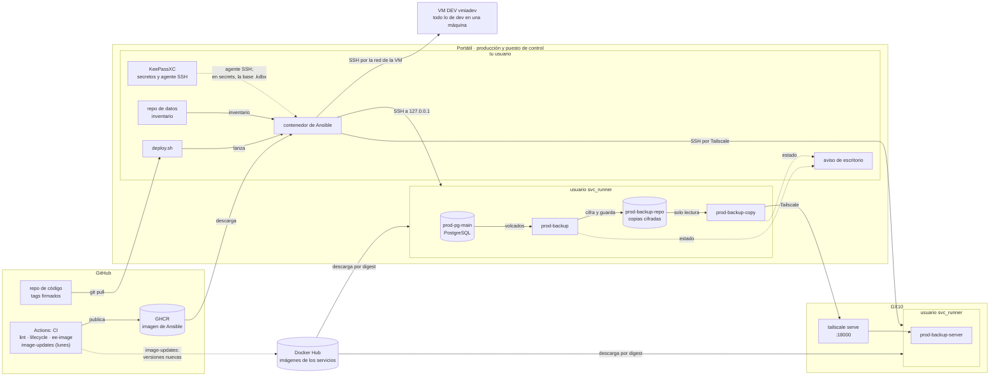
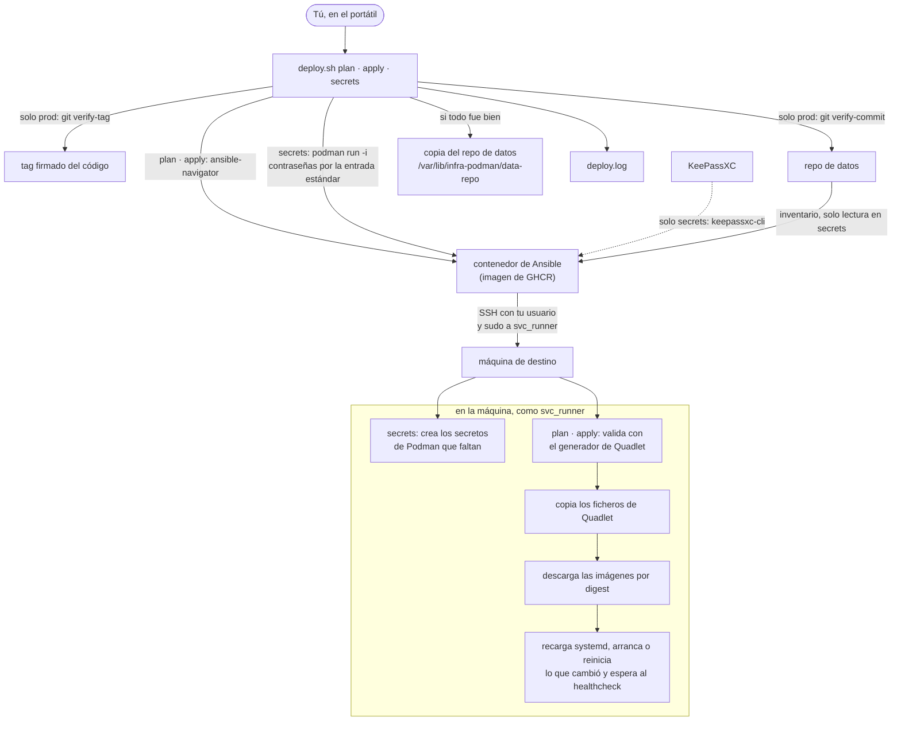
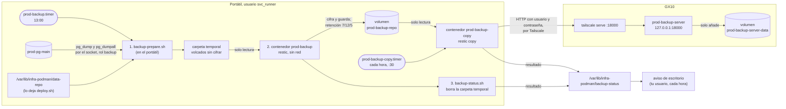

# Arquitectura

Cómo está montada la plataforma, para entenderla de un vistazo. Solo lo que ya existe (fase 1). Cada PR que añada o cambie una pieza actualiza este documento.

## 1. El centro: el portátil

El portátil hace dos papeles a la vez (R18):

- **Puesto de control.** Desde él se despliega todo. Allí están la copia del código, el repo de datos, KeePassXC y `deploy.sh`.
- **Servidor de producción.** Aloja la base de datos (`prod-pg-main`) y hace las copias de seguridad.

**En qué se apoya:** Fedora Atomic Sway 44 con SELinux activo, Podman 5 sin root, el disco cifrado (LUKS y VeraCrypt) y KeePassXC con su agente SSH.

**Qué se despliega:**
- en el portátil: el usuario de servicio, Postgres y los backups;
- en el GX10: el usuario de servicio y el servidor que guarda la copia de los backups;
- en la VM DEV: lo mismo que en las dos máquinas juntas, para probar antes.

Las aplicaciones (Firefly III, pgAdmin…) llegan en la fase 2.

## 2. Mapa de la plataforma

Las flechas de puntos son lecturas locales, sin red. Lo único que sale del portátil hacia otra máquina es Ansible (por SSH) y la copia de los backups (por Tailscale), siempre cifrada.

## 3. Las piezas

| Pieza | Para qué sirve | Dónde vive | Con qué habla |
| --- | --- | --- | --- |
| **GitHub: repo de código** | El código, la documentación y los digests de las imágenes. Privado. Solo cambia por PR mergeado | `laperl/infra-podman`; tu copia en `~/Documents/src/github.com/laperl/infra-podman` | Tu copia, con `git` por SSH (clave del agente de KeePassXC) |
| **GitHub: tags firmados** | El control de producción: `deploy.sh` solo despliega en prod un tag firmado con tu clave (R4) | Tags del repo; la lista de claves de confianza, fuera de los repos: `~/.config/infra-podman/allowed_signers` | `deploy.sh`, que los comprueba con `git verify-tag` |
| **GitHub: CI** | Prueba cada cambio antes del merge: `lint` (sintaxis, política de Quadlet, generador de Podman 4.9), `lifecycle` (despliega de verdad en una máquina de GitHub con Podman 4.9) y `ee-image` (construye la imagen de Ansible). Cada lunes, `image-updates` avisa por correo si hay una versión nueva de una imagen. Nunca toca tus máquinas ni KeePassXC | GitHub Actions, máquinas Ubuntu 24.04 sin SELinux | Con GitHub y GHCR; `image-updates` lee además Docker Hub |
| **GHCR: imagen de Ansible** (`infra-podman-ee`) | Ansible, sus colecciones y `keepassxc-cli`, con las versiones fijadas | Paquete privado en GHCR; fijada por digest en `ansible-navigator.yml` | La publica `ee-image`; la descarga tu Podman con un token de solo lectura |
| **Docker Hub** | Las imágenes de los servicios: `pgvector/pgvector`, `restic/restic` y `restic/rest-server` | `docker.io`; fijadas por digest en `playbooks/group_vars/all/images.yml` | Las descarga `svc_runner` en cada máquina durante un `apply` |
| **Repo de datos** | Tu inventario: máquinas, instancias, superusuario, nombre de la instalación (`infra_site`), qué secretos hay. Sin contraseñas | `~/Documents/SECURE_vc/ansible/infra-podman`, solo en el portátil, en el volumen cifrado, sin GitHub. Commits firmados (R38) | `deploy.sh` lo lee y comprueba su firma en prod. Tras cada ejecución correcta deja una copia en `/var/lib/infra-podman/data-repo` para el backup |
| **KeePassXC** | La copia maestra de los secretos (`infra-pro.kdbx`, y `infra-dev.kdbx` con valores falsos) y el agente SSH con tus claves de acceso y de firma | En el portátil, fuera de los repos. Grupo `<instalación>` (R42) | `deploy.sh secrets` lo lee con `keepassxc-cli`; `git` y SSH usan su agente |
| **`deploy.sh`** | La única entrada: `plan`, `apply` y `secrets`. En prod exige tag firmado, código limpio, datos firmados y escribir `prod` | En la raíz del repo de código; configuración en `~/.config/infra-podman/deploy.conf`; registro en `~/.local/state/infra-podman/deploy.log` | Lanza el contenedor de Ansible y le pasa el inventario del repo de datos |
| **Contenedor de Ansible** | Ejecuta los playbooks. Solo existe mientras dura un `deploy.sh` | En el portátil, con tu usuario y la red del portátil (`--network=host`, R23) | Por SSH con cada máquina, con tu usuario; allí cambia a `svc_runner` con sudo |
| **Usuario de servicio `svc_runner`** | Dueño de todos los contenedores. Sin contraseña ni shell; con linger, sus servicios arrancan al encender sin que nadie entre (D3) | Portátil, GX10 y VM DEV | Solo Ansible entra en él, con sudo. Tú lo miras con la función `svc` (`SETUP.md`, paso 12) |
| **Quadlet y systemd** | Cada contenedor es un fichero de Quadlet que systemd convierte en un servicio de `svc_runner`. Unos arrancan al encender; otros los despierta un temporizador | `~svc_runner/.config/containers/systemd/` (contenedores y volúmenes) y `~svc_runner/.config/systemd/user/` (temporizadores) | Los instala Ansible tras validarlos con el generador de Quadlet de la propia máquina (SPEC 4.2) |
| **Postgres** (`prod-pg-main`) | La base de datos principal (PostgreSQL 18 con pgvector), según [`POSTGRES.md`](POSTGRES.md) | Portátil; datos en el volumen `prod-pg-main-data` | Sin puertos. Sin consumidores, `Network=none` (R30); con ellos, una red interna y aislada por consumidor, y cada usuario solo entra desde la suya (R45). Se administra por su socket con `podman exec` |
| **Backup local** (`prod-backup`) | Una copia diaria, cifrada con restic, de todas las bases y del repo de datos. Guarda 7 diarias, 12 mensuales y 5 anuales | Portátil; copias en el volumen `prod-backup-repo` | Antes de arrancar, el servicio vuelca las bases desde `prod-pg-main`. El contenedor no tiene red |
| **Copia al GX10** (`prod-backup-copy`) | Cada hora, envía al GX10 las copias que le faltan | Portátil | Lee `prod-backup-repo` en solo lectura y habla por Tailscale con el servidor de copias |
| **Servidor de copias** (`prod-backup-server`) | rest-server de restic: recibe las copias y solo deja añadir, nunca borrar (R44). Pide usuario y contraseña; tope de 30 GB | GX10; copias en el volumen `prod-backup-server-data`, carpeta `<instalación>/prod-laptop` | Solo escucha en `127.0.0.1`; le llega la copia a través de `tailscale serve` |
| **Aviso de escritorio** | Cada hora mira el resultado de las copias y te avisa si algo falla o es antiguo | Portátil, en **tu** usuario (`infra-podman-backup-notify.timer`) | Lee `/var/lib/infra-podman/backup-status/`; muestra la notificación con `notify-send` |
| **GX10** | Guarda la copia externa de los backups. Su disco no está cifrado: solo recibe datos cifrados. vLLM corre aparte en Docker y Ansible no lo toca (SPEC 4.7) | Ubuntu 24.04 ARM64 (DGX OS 7), Podman 4.9 | Con el portátil, solo por Tailscale |
| **Tailscale** | La red privada entre tus máquinas. Nada se abre a internet (R25) | Portátil y GX10. La VM DEV no lo tiene | SSH del portátil al GX10, y la copia de los backups con `tailscale serve --tcp=18000` |
| **SELinux** | Aísla los contenedores en el portátil. Cada volumen va marcado como privado de su contenedor (`:Z`). Excepciones: el contenedor de Ansible (`label=disable`, R16) y la copia al GX10 (`SecurityLabelDisable`, R44), que necesitan leer algo de otro | Portátil (Fedora). El GX10, la VM DEV y el CI son Ubuntu: no lo aplican | — |
| **VM DEV** (`vmiadev`) | Probar cada cambio antes de producción, con la misma versión de Podman que el GX10. Todo con `dev-` delante, y servidor y copia en la misma máquina | Dentro del portátil; Ubuntu 24.04, Podman 4.9, sin Tailscale | Ansible le llega por SSH a través de la red de la VM. No ve nada de producción (R2, R17) |

## 4. Puertos

Solo los de la infraestructura; los de cada aplicación se añadirán con ella.

| Máquina | Escucha en | Qué | Quién llega |
| --- | --- | --- | --- |
| Portátil | `127.0.0.1:22` | sshd, solo con clave (R23) | El contenedor de Ansible, desde el propio portátil |
| GX10 | `:22` | sshd | Ansible desde el portátil, por Tailscale. Lo que escucha hoy fuera de Tailscale lo revisa la fase 1b (cortafuegos) |
| GX10 | `127.0.0.1:18000` | `prod-backup-server` (dentro del contenedor, el 8000) | Solo `tailscale serve` |
| GX10 | `:18000` en la red de Tailscale | `tailscale serve --tcp=18000` | `prod-backup-copy`, desde el portátil |
| VM DEV | `:22` en la red de la VM | sshd | Ansible desde el portátil |
| VM DEV | `127.0.0.1:18000` | `dev-backup-server` | Tú, a mano. `dev-backup-copy` entra directo por la red del servidor (`Network=container:dev-backup-server`) |

- **Postgres no tiene puerto:** ni en `127.0.0.1` ni en ninguna red. Solo su socket, dentro del contenedor.
- **Nada abierto a internet** ni a la red de casa por esta plataforma.
- En el GX10 hay otras cosas que no son de esta plataforma (vLLM en Docker, una página tuya en `tailscale serve`). Ansible no las toca.

## 5. Cómo se maneja

Todo cambio es un PR, un tag firmado y `deploy.sh plan`/`apply` desde el portátil, una máquina cada vez con `--limit`: [`WORKFLOW.md`](WORKFLOW.md). El día a día (qué está en marcha, el estado de las copias, cómo restaurar): [`OPERATIONS.md`](OPERATIONS.md).

## 6. En detalle

### 6.1 Despliegue

- **`secrets`** no usa ansible-navigator: lanza la imagen con `podman run -i` y le pasa la contraseña maestra y la de sudo por la entrada estándar. Nunca van en argumentos, variables guardadas ni ficheros (R11, R29).
- **`plan` y `apply`** usan ansible-navigator, que pide la contraseña de sudo en tu terminal (R24). Como cada máquina tiene la suya, en prod va siempre `--limit`.
- **Si un healthcheck no pasa**, Ansible para ese servicio y te avisa. Nunca vuelve atrás de imagen solo (D11).
- **Antes de cambiar la imagen de Postgres**, el rol `postgres` lanza un backup (`reason=pre-upgrade`) y espera. Si falla, no cambia nada.

| Playbook | Portátil | GX10 | VM DEV |
| --- | --- | --- | --- |
| `check` (solo lee) | Sí | Sí | Sí |
| `base` (usuario de servicio) | Sí | Sí | Sí |
| `secrets` (con `deploy.sh secrets`) | Sí | Sí | Sí |
| `postgres` | Sí | No | Sí |
| `backup` (copia diaria, envío y aviso) | Sí | No | Sí |
| `backup-server` | No | Sí | Sí |

### 6.2 Backups

- **Separación de permisos.** Los volcados los hace el servicio en el portátil, con el rol `backup` de Postgres, que solo lee. El contenedor de restic no tiene red y no llega a Postgres. La copia al GX10 solo ve el repositorio cifrado, en solo lectura.
- **El volcado sin cifrar vive solo mientras dura la copia**: al terminar, bien o mal, se borra la carpeta temporal.
- **Cada cosa es una copia** (snapshot) con su ruta, `/backup/pg-main/pgdump/<base>`, `/backup/pg-main/pgdump/_roles` o `/backup/infra-podman/files/data-repo`, y sus etiquetas: `site`, `env`, `app`, `type` y `reason` (`daily` o `pre-upgrade`).
- **Si el GX10 no responde**, la copia termina sin error y lo reintenta a la hora siguiente. El aviso solo salta si pasan 7 días sin una copia buena, si una copia falla o si el servidor pasa del 80 % de su tope.
- **Para leer las copias basta la clave de restic** (`backup-restic-password`). El GX10 nunca la tiene: no puede leerlas ni borrarlas. En el GX10 no se borra nada (R26).
- **Pérdida aceptada:** lo hecho desde la última copia diaria y, si se pierde el portátil, desde la última copia que llegó al GX10.
