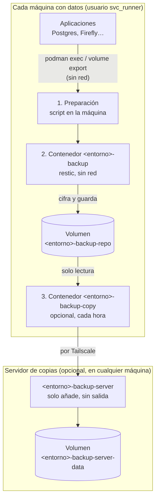

# Copias de seguridad: cómo funcionan

Para entender las copias de un vistazo: quién las hace, dónde quedan, cómo llegan a otra máquina y cómo se miran. Las órdenes del día a día y cómo restaurar están en [`OPERATIONS.md`](OPERATIONS.md), apartados 2, 3 y 5. La regla es SPEC 4.11.

## 1. La idea en cinco líneas

- **Un solo servicio de copias por máquina** (`<entorno>-backup`) copia los datos de **todas** las aplicaciones de esa máquina. Las aplicaciones no hacen nada.
- **Las copias quedan en la misma máquina**, cifradas, en un volumen: `<entorno>-backup-repo`.
- **Opcional: un servidor de copias** (`<entorno>-backup-server`), en la máquina que quieras. Cada máquina le **envía** sus copias; el servidor nunca va a buscarlas.
- **Sin servidor configurado, solo hay copia local.** Todo lo demás funciona igual.
- **Nada se borra del origen al enviar.** El servidor solo deja añadir: ni el portátil ni quien entre en él puede borrarle copias.

## 2. El recorrido de una copia



El dibujo con todos los detalles (temporizadores, ficheros de estado, aviso de escritorio) está en [`ARCHITECTURE.md`](ARCHITECTURE.md), apartado 6.2.

## 3. Las piezas

Con `prod`; en DEV, cambia `prod` por `dev`.

| Pieza | Qué es | Cuándo | Dónde |
| --- | --- | --- | --- |
| `prod-backup.timer` | Lanza la copia diaria | Una vez al día (`backup_time`, por defecto 13:00). Si la máquina estaba apagada, al encender | Cada máquina con datos |
| `prod-backup.service` | Preparación + contenedor de restic sin red | Lo lanza el temporizador, o tú a mano | Cada máquina con datos |
| `prod-backup-repo` | **El volumen con las copias locales**, cifradas | — | Cada máquina con datos |
| `prod-backup-copy.timer` y `.service` | Envía al servidor las copias que le falten | Cada hora (minuto 30). Solo si hay servidor configurado | Cada máquina con datos |
| `prod-backup-server.service` | El servidor de copias (rest-server de restic) | Siempre en marcha | La máquina que elijas |
| `prod-backup-server-data` | El volumen con las copias recibidas | — | La del servidor |

**Playbooks:** `backup` instala lo de cada máquina con datos (grupo `backup_clients`) y `backup-server`, el servidor (grupo `backup_servers`). Con `./deploy.sh apply backup` basta para tener copias locales.

## 4. Qué se copia

Solo hay **dos formas** de copiar algo:

| Forma | Qué hace | Para qué |
| --- | --- | --- |
| **Una orden** | Ejecuta dentro del contenedor la herramienta que saca los datos y guarda lo que imprime | Bases de datos y aplicaciones con exportador propio |
| **Un volumen** | Copia un volumen entero desde fuera, con `podman volume export` | Ficheros: adjuntos, subidas. Funciona con el contenedor parado |

- **Postgres va siempre**, sin configurar nada: es la forma «orden», ya preparada, que lanza un `pg_dump` por cada base. Así cada base tiene su propia copia y se restaura sola.
- **Lo demás lo activas tú, por instancia**, con `backup:` y los nombres que ofrece cada aplicación ([`services/README.md`](services/README.md), apartado 8). Puedes activar varios. Sin `backup:`, de esa aplicación solo se copia su base.
- **En el portátil, además, tu repo de datos** (`backup_data_repo`).
- **Cómo llega a los datos:** con Podman, desde fuera, como dueño de los contenedores. No usa la red, así que da igual que la aplicación esté en una red interna o sin red.

Para ver qué copia exactamente una máquina: `./deploy.sh plan check --env prod`, bloque `COPIAS` ([`OPERATIONS.md`](OPERATIONS.md), apartado 4). Ahí sale también lo que queda `FUERA DE LA COPIA`.

## 5. Mirar las copias

Las órdenes usan la función `svc` ([`SETUP.md`](SETUP.md), paso 12), en la máquina que tiene las copias.

**Los temporizadores**, con la próxima ejecución y la última:

```bash
svc systemctl --user list-timers 'prod-backup*'
```

**Cómo fue la última copia y el último envío:** los ficheros de estado y los logs, en [`OPERATIONS.md`](OPERATIONS.md), apartado 2.

**Qué copias hay en el volumen `prod-backup-repo`** (todas, con su fecha y su motivo):

```bash
img=$(sudo sed -n 's/^Image=//p' ~svc_runner/.config/containers/systemd/prod-backup.container)
svc podman run --rm --network=none --security-opt label=disable -v prod-backup-repo:/repo:ro \
  --secret prod-backup-restic-password,type=env,target=RESTIC_PASSWORD -e RESTIC_REPOSITORY=/repo \
  "$img" --no-lock snapshots
```

- Solo lee (`:ro`, `--no-lock`): no cambia nada.
- Cada línea es una copia de una cosa. Su ruta dice qué es, `/backup/<aplicación>/<forma>/<nombre>`, y su etiqueta `reason=` por qué se hizo: `daily`, `pre-upgrade`, `pre-drop` o `pre-purge`.
- Es la misma orden que [`OPERATIONS.md`](OPERATIONS.md), apartado 2, prueba en el CI con `--latest 1` (solo la última de cada cosa).

**Cuánto ocupa el volumen:**

```bash
svc podman system df -v | grep prod-backup-repo
```

## 6. Retención: cuánto se guarda

- **En la máquina:** 7 copias diarias, 12 mensuales y 5 anuales **de cada cosa y de cada motivo**, por separado. Una copia diaria nunca borra la que se hizo antes de un cambio de imagen o de un borrado. Se aplica sola al final de cada copia diaria.
- **En el servidor de copias:** no se borra nada. Lo limita un tope de tamaño (`backup_server_max_size_gb`, 30 GB); el estado del envío dice cuánto llevas.

Para ver la retención que tiene instalada una máquina:

```bash
sudo grep BACKUP_KEEP ~svc_runner/.config/containers/systemd/prod-backup.container
```

Y la que se aplicó en la última copia, en su log (línea `retention:`):

```bash
sudo journalctl _SYSTEMD_USER_UNIT=prod-backup.service -n 50 | grep retention
```

## 7. Lo que puedes ajustar

En tu repo de datos, y después `./deploy.sh apply backup`:

| Qué | Variable | Por defecto |
| --- | --- | --- |
| Hora de la copia diaria | `backup_time` | `"13:00"` |
| Retención | `backup_keep_daily`, `backup_keep_monthly`, `backup_keep_yearly` | `7`, `12`, `5` |
| Copiar también el repo de datos | `backup_data_repo` | `false` |
| Aviso de escritorio si una copia falla o es vieja | `backup_notify` | `false` |
| **Enviar a un servidor de copias** | `backup_remote_url`: `http://<IP del servidor>:<puerto>`. La IP, no el nombre: el contenedor que envía solo tiene salida a esa dirección, donde la máquina puede limitarla ([`services/README.md`](services/README.md), apartado 4) | vacío: solo copia local |
| Tope de tamaño del servidor | `backup_server_max_size_gb` | `30` |
| Qué más copiar de una aplicación | `backup:` en su instancia | nada |

## 8. El servidor de copias, en detalle

- **Es opcional y puede estar en cualquier máquina**, también en la misma (así es en DEV). Uno solo sirve a todas tus máquinas: cada una entra con el usuario de la instalación y solo ve su carpeta, `<instalación>/<entorno>-<máquina>`.
- **Quién se conecta a quién:** siempre la máquina con datos al servidor, por Tailscale. El servidor no inicia ninguna conexión y no necesita llegar a las aplicaciones.
- **Si el servidor está apagado**, no es un fallo: el envío lo reintenta cada hora y se pone al día.
- **Qué protege:** si pierdes o te entran en la máquina con datos, las copias del servidor siguen ahí y no se pueden borrar desde ella. Quien entre en el servidor solo ve datos cifrados: la clave de restic está en tu KeePassXC.

## 9. Y además

| Para | Dónde |
| --- | --- |
| Restaurar una base, el repo de datos o una máquina entera | [`OPERATIONS.md`](OPERATIONS.md), apartado 5 |
| Restaurar un volumen de una aplicación | [`services/README.md`](services/README.md), apartado 8 |
| Lanzar una copia o un envío ahora | [`OPERATIONS.md`](OPERATIONS.md), apartado 3 |
| Una copia falla | [`TROUBLESHOOTING.md`](TROUBLESHOOTING.md) |
| Los secretos de las copias | [`SECRETS_INVENTORY.md`](SECRETS_INVENTORY.md) |
| Por qué es así | SPEC 4.11 y [`DECISIONS.md`](DECISIONS.md): R19, R28, R43 y R44 |
