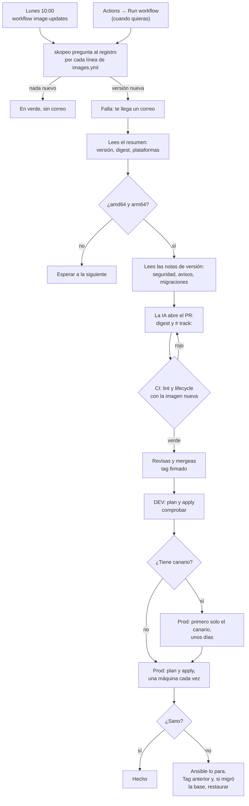

# Actualizar la imagen de un contenedor

Cómo pasa una aplicación a una versión nueva de su imagen: el aviso, qué mirar, el cambio, el despliegue y qué hacer si sale mal. Los pasos generales de un cambio (PR, DEV, tag, producción) están en [`WORKFLOW.md`](WORKFLOW.md); aquí solo lo propio de una imagen.

Esto es solo para las imágenes. Los otros cambios se hacen así:
- **Los ajustes de una instancia** (puerto, memoria, copias…) están en el repo de datos: «Cambiar datos» de [`WORKFLOW.md`](WORKFLOW.md).
- **Cómo se despliega** (rol, plantillas) es un PR en este repo, como cualquier otro.



## 1. Cómo te enteras

Cada lunes a las 10:00 (hora de Madrid), el workflow `image-updates` usa `skopeo` para preguntar al registro por cada línea de [`images.yml`](../playbooks/group_vars/all/images.yml). Cada línea fija una imagen por digest (D6) y dice qué etiqueta sigue (`# track:`). Hay novedad en dos casos:
- **Una versión mayor con la misma forma.** Si sigue `9.19`, le vale una `9.20`, pero no una `9.20-rc1` ni `latest`.
- **Una etiqueta que se mueve**, como `pg18`, que ya apunta a otro digest.

Si hay novedad, **el workflow falla y GitHub te manda un correo**. Solo lee: nunca cambia nada. Para mirarlo sin esperar al lunes: Actions → `image-updates` → **Run workflow**.

## 2. Qué mirar antes de pedir el cambio

1. **El resumen de la ejecución en rojo:** la imagen, la versión nueva, su digest y sus plataformas. Tienen que salir `linux/amd64` y `linux/arm64`. Si falta una, se espera a la siguiente versión.
2. **Las notas de versión de la aplicación.** Cuatro preguntas:
   - **¿Corrige vulnerabilidades?** Entonces es urgente. Mira si te afectan con tu montaje: muchas son de funciones que no usas.
   - **¿Trae avisos para quien actualiza?** Por ejemplo, el `SERVER_PASSEXEC_COMMANDS` de pgAdmin 9.19, que pide configurarse antes del primer arranque tras actualizar.
   - **¿Cambian las variables de la imagen o sus rutas?** Entonces el PR toca también el rol, no solo el digest.
   - **¿Migra la base de datos?** Firefly lo hace al arrancar una versión nueva, y no se deshace sola (apartado 6).
3. **Postgres:** se sigue `pg18`, que solo trae versiones menores. Pasar a la 19 no es cambiar la imagen: es volcar y restaurar, con un plan aparte.

## 3. Comprobarlo tú con `skopeo`

Es opcional: el workflow ya lo hace. Sirve para mirar una imagen antes de proponerla o para darle el digest a la IA. En cualquier máquina con `skopeo` y `jq`:

```bash
skopeo list-tags docker://docker.io/<repositorio> | jq -r '.Tags[]' | grep -E '^[0-9.]+$' | sort -V | tail -3
skopeo inspect --raw docker://docker.io/<repositorio>:<versión> | sha256sum
skopeo inspect --raw docker://docker.io/<repositorio>:<versión> | jq -r '.manifests[].platform | "\(.os)/\(.architecture)"'
```

1. Las últimas versiones. `sort -V` ordena como versiones: sin él, la `9.9` sale después de la `9.19`.
2. El digest que va en `images.yml`, el del índice de todas las plataformas.
3. Sus plataformas. Las `unknown/unknown` son manifiestos de atestación, no imágenes.

## 4. El cambio

1. **Pide el PR a la IA** con el digest: cambia la línea de `images.yml` y la versión de `# track:`. Si las notas de versión lo piden, toca también el rol.
2. **El CI arranca la imagen nueva de verdad:** `lint` y `lifecycle` despliegan, comprueban y retiran la aplicación en una máquina desechable.
3. **Revisas, mergeas y creas el tag firmado** ([`WORKFLOW.md`](WORKFLOW.md), pasos 2 a 5).

## 5. Desplegar

1. **En DEV:** `./deploy.sh plan <app> --env dev`, luego `apply`. Comprueba con `./deploy.sh plan check --env dev` y con [`OPERATIONS.md`](OPERATIONS.md), apartado 4.
2. **En producción:** igual, una máquina cada vez ([`WORKFLOW.md`](WORKFLOW.md), paso 6). Si la aplicación tiene canario, primero solo él (apartado 7).

Lo que hace cada aplicación sola al cambiar de imagen:

| Aplicación | Antes del cambio | Si no queda sana |
| --- | --- | --- |
| Postgres | Una copia (`reason=pre-upgrade`); si falla, no cambia la imagen | Ansible la para y no vuelve atrás solo |
| Firefly III | Una copia de su base (`reason=pre-upgrade`); si falla, no cambia la imagen | Ansible la para y no vuelve atrás solo |
| pgAdmin 4 | Nada: perder su volumen cuesta poco ([`services/pgadmin.md`](services/pgadmin.md), apartado 6) | Ansible la para y no vuelve atrás solo |
| Backup (restic) | Nada | La copia siguiente falla y te avisa el escritorio |

## 6. Si sale mal

1. **Ansible para el servicio, pero no vuelve atrás solo.** Sus logs: [`TROUBLESHOOTING.md`](TROUBLESHOOTING.md), en el apartado de esa aplicación.
2. **Vuelve a la versión anterior:** saca el tag anterior (`git checkout v<anterior>`) y `plan` y `apply` de esa aplicación ([`WORKFLOW.md`](WORKFLOW.md), paso 6).
3. **Si la versión nueva ya migró la base,** la anterior puede no arrancar con ella. Restaura la copia `pre-upgrade` ([`OPERATIONS.md`](OPERATIONS.md), apartado 5.1) y después aplica la versión anterior.

## 7. El canario

Un canario es una **segunda instancia de la misma aplicación** que recibe la versión nueva antes que la de verdad. Si la versión nueva rompe algo, lo rompe en el canario, con datos de prueba, y tu instancia de verdad sigue intacta.

**Cuándo merece la pena:** en aplicaciones que migran su base al actualizar y cuyos datos te importan, como Firefly. En pgAdmin o en el backup no: no tienen una base que migrar y se recuperan rápido.

**Lo que cuesta:** una instancia más, siempre en marcha, con su base, sus dos secretos y su puerto. Firefly gasta poco (unos 70 MB).

### Montarlo, una sola vez (Firefly)

1. **Una línea más en `images.yml`, en este repo:** la imagen del canario, de momento la misma que la de verdad.
   ```yaml
   firefly_image: "docker.io/fireflyiii/core@sha256:<digest>"         # track: version-6.7.9
   firefly_canary_image: "docker.io/fireflyiii/core@sha256:<digest>"  # track: version-6.7.9
   ```
2. **La instancia `canary`, en el repo de datos.** El ejemplo ya está comentado en `inventory.example/prod/group_vars/firefly_hosts.yml`. Hay que añadir su base `ff_canary` en `postgres_hosts.yml` y sus secretos `ff-canary-db-password` y `ff-canary-app-key` (los mismos pasos que `casa`, [`services/INSTALL.md`](services/INSTALL.md)). Se le añade una línea:
   ```yaml
     - name: canary
       image: firefly_canary_image     # la línea de images.yml que sigue esta instancia
       ...
   ```
3. **Mete en el canario datos parecidos a los tuyos,** inventados o una copia, y úsalo de vez en cuando.

### Cada versión nueva

1. **Primer PR: solo `firefly_canary_image`** pasa al digest nuevo. Despliegas: solo cambia el canario, con su copia `pre-upgrade` antes.
2. **Unos días usándolo.** ¿Arranca, migra, se ven bien tus datos de prueba, funcionan las tareas diarias?
3. **Segundo PR: `firefly_image`** pasa al mismo digest. Ahora se actualiza tu instancia de verdad, sabiendo que esa versión ya funciona aquí.
4. **Si el canario sale mal:** no haces el segundo PR. Vuelves el canario atrás (apartado 6) o esperas a la versión siguiente. Tu instancia de verdad no se ha enterado.

`image-updates` avisa de las dos líneas por separado, así que cada versión nueva te llega dos veces hasta que las dos están al día.
