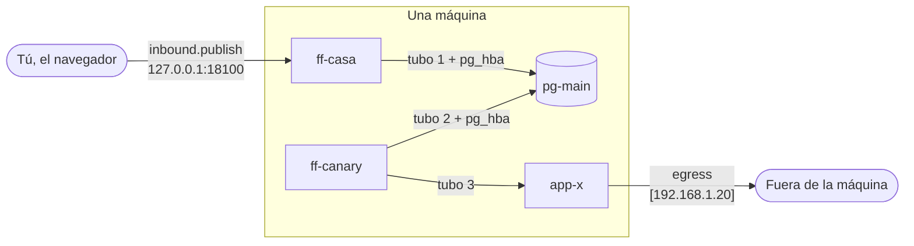
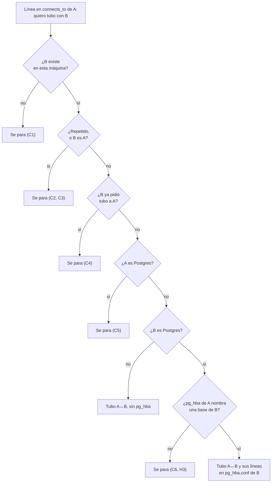

# La red

Cómo habla cada contenedor de la plataforma, en una página (R59). Es la fuente de verdad de la red: SPEC 4.4 la resume y [`services/README.md`](services/README.md), apartados 4 y 9, la aplica a cada aplicación. Qué no admite Podman 4.9 y por qué: [`COMPATIBILITY.md`](COMPATIBILITY.md).

## 1. Dos tipos de conexión

| Conexión | Se escribe en | Qué crea |
| --- | --- | --- |
| **Dentro de la máquina**, de un contenedor a otro | `networking.connects_to` (y, si el destino es Postgres, `pg_hba`) | Una red interna por pareja, solo para los dos |
| **Desde fuera** hacia un contenedor | `networking.inbound` (`publish`, `tailscale_serve`) | Un puerto publicado en la dirección que escribes |
| **Hacia fuera** desde un contenedor | `networking.egress` | Una red propia del contenedor, con salida a lo que escribes |

**Dentro o fuera, nunca mezclado.** `connects_to` es solo para hablar con otro contenedor de **la misma máquina**. `inbound` y `egress` son solo para hablar con **fuera de la máquina**: `inbound`, lo que entra (un navegador, otra máquina por Tailscale); `egress`, lo que sale (internet, la red local, otra máquina). Para hablar con un contenedor de otra máquina se usan los dos: `inbound` en el destino y `egress` en el origen.

**Lo que no escribes está cerrado.** Un contenedor sin nada de esto queda con `Network=none`. La red del host está prohibida (SPEC 8).



- La flecha de un tubo va de quien **lo pide** (lo escribe en su `connects_to`) a quien **lo recibe**.
- Un tubo une a dos y nadie más lo usa: `ff-casa` no ve a `ff-canary`, ni a `app-x`.
- Entre dos máquinas no hay tubos: en el destino se escribe `inbound`, y en el origen, `egress`.

## 2. Cómo se escribe

```yaml
# group_vars/firefly_hosts.yml del repo de datos
firefly_instances:
  - name: casa
    networking:
      inbound:
        publish: ["127.0.0.1:18100:8080"]   # quién entra desde fuera
      connects_to: [pg-main]                # con quién habla dentro de la máquina
      # egress: ["192.168.1.20"]            # a dónde sale de la máquina
    pg_hba:                                 # qué bases de ese Postgres usa
      - {instance: pg-main, database: ff_casa}
```

```yaml
# group_vars/postgres_hosts.yml: Postgres no nombra a sus clientes
postgres_instances:
  - name: main
    superuser: admin_main
    databases:
      - name: ff_casa
        users:
          - {name: ff_casa, group: owner}
```

Cada instancia se nombra por su identificador `<corto>-<instancia>` ([`NAMING.md`](NAMING.md)): `ff-casa`, `pg-main`.

## 3. `connects_to`: las reglas

Para cada línea de `connects_to` de la instancia A hacia B:

| # | Regla | Si no se cumple |
| --- | --- | --- |
| C1 | B es una instancia de esta máquina | El `plan` de A se para |
| C2 | B no está repetido | Se para |
| C3 | B no es A | Se para |
| C4 | B no tiene ya A en su `connects_to`: la pareja se escribe una vez, en quien inicia la conversación | Se para |
| C5 | A no es Postgres: Postgres no inicia conexiones | Se para (en el rol de Postgres) |

Además, cada aplicación pide lo que necesita para funcionar en su contrato ([`services/README.md`](services/README.md), apartado 9). Firefly, por ejemplo, exactamente un `pg-*` en su `connects_to`.

Hay dos tipos de instancia (aplicación y Postgres) y dos papeles en un tubo (pide y recibe), así que solo hay cuatro combinaciones:

| Pide → recibe | `pg_hba` | Resultado |
| --- | --- | --- |
| aplicación → aplicación | No se escribe | Funciona |
| aplicación → Postgres | Obligatorio (apartado 4) | Funciona |
| Postgres → aplicación | — | Se para (C5) |
| Postgres → Postgres | — | Se para (C5). Una réplica o `postgres_fdw` se decidirían aparte; una réplica pediría la palabra especial `replication` en `pg_hba.conf` |

**La red** de cada pareja se llama `<entorno>-<quien pide>-<quien recibe>-net` (`prod-ff-casa-pg-main-net`). Es interna (sin salida a internet, a la red local ni al host), con `isolate=true` y con `DNS=127.0.0.1`, para que tampoco salgan consultas de DNS. Su subred la elige Podman (R45). Dentro de la pareja, cada contenedor encuentra al otro por su nombre (`prod-pg-main`).

El nombre no se repite nunca: un identificador tiene exactamente un guion (el nombre corto son letras y la instancia, letras y cifras), así que `<quien pide>-<quien recibe>` se lee de una sola manera.

## 4. `pg_hba`: quién entra en qué base

Va en la instancia que pide el tubo a un Postgres, fuera de `networking`:

```yaml
pg_hba:
  - {instance: pg-main, database: ff_casa}
```

**Qué genera.** Por cada entrada, en el `pg_hba.conf` de esa instancia de Postgres hay una línea por cada usuario declarado en esa base:

```
host  "ff_casa"  "<usuario>"  <subred del tubo ff-casa ↔ pg-main>  scram-sha-256
```

- Solo a esa base y solo desde la red de esa pareja.
- Nunca se escribe `all` como usuario: un usuario que no está declarado en esa base no entra.
- Las líneas que ya existían van antes y no cambian: el superusuario y `backup` siguen sin entrar por TCP (en `pg_hba.conf` gana la primera línea que coincide). El resto se rechaza al final.

**Lo que hay que saber.** Si una base tiene varios usuarios, o la nombran dos aplicaciones, cualquiera de ellas puede intentar entrar con cualquiera de esos usuarios. La segunda barrera es la contraseña: un contenedor solo recibe los secretos que lo nombran en `readers:` de `infra_secrets` (SPEC 4.5). Es una decisión del operador (R59, 2026-11-17).

Las reglas de cada entrada `{instance: P, database: D}` de la instancia A:

| # | Regla | Si no se cumple |
| --- | --- | --- |
| H1 | P es una instancia de Postgres de esta máquina | El `plan` de A se para |
| H2 | P está en el `connects_to` de A: sin tubo no hay por dónde llegar | Se para |
| H3 | D es una base declarada en P (`postgres_hosts.yml`) | El `plan` de A se para. El de Postgres lo avisa e ignora esa entrada: ni red ni línea en `pg_hba.conf` |
| H4 | La entrada no está repetida | Se para |
| H5 | A no es Postgres | Se para |
| C6 | Cada Postgres del `connects_to` de A tiene al menos una entrada | Se para |

`consumer:` en los usuarios de Postgres ya no se lee: el `plan` de Postgres se para si lo encuentra (apartado 11).

## 5. Qué hace cada `plan`

Cada rol comprueba lo suyo, y nada cambia en la máquina cuando algo se para.

| `plan` de… | Se para si… | Solo avisa si… |
| --- | --- | --- |
| La aplicación (A) | C1–C4, C6, H1–H4, su contrato; o la red con su Postgres no existe todavía (falta el `apply` de Postgres) | — |
| Postgres (P) | `consumer:` en un usuario; `networking` o `pg_hba` en una instancia de Postgres (C5, H5) | Una aplicación nombra en `pg_hba` una base que P no tiene (la ignora; si no queda ninguna, tampoco le da red); una base que no nombra nadie (se conserva, pero nadie entra) |

Postgres crea la red de una pareja **solo cuando la aplicación nombra en `pg_hba` una base que existe en él**. Red y permiso aparecen y desaparecen juntos.



## 6. Con el tiempo: crear, quitar y el orden

| Haces | Qué pasa |
| --- | --- |
| Añadir un tubo entre dos aplicaciones | Cualquiera de los dos lados crea la red, con la misma plantilla (`roles/quadlet_deploy/templates/pair.network.j2`), así que el fichero es el mismo lo escriba quien lo escriba. **El orden de los `apply` no importa** |
| Añadir un tubo hacia Postgres | La red la crea el rol de Postgres, porque `pg_hba.conf` necesita su subred: **primero `apply postgres`**, después la aplicación. Si es al revés, el `plan` de la aplicación se para y lo dice |
| Las dos instancias de la pareja | Cambia su unidad y las dos se reinician. Si una es Postgres, sus clientes se cortan un momento |
| Quitar un tubo (borrar la línea) | Cada lado, en su `apply`, deja la red. La borra el que va último, cuando ya no la usa ningún contenedor ni la nombra ninguna unidad (`roles/quadlet_deploy/tasks/pair_gc.yml`). Mientras tanto se conserva y el `apply` lo dice. **El orden no importa** |
| Quitar una base de `pg_hba` | Sus líneas desaparecen de `pg_hba.conf` (se recarga, sin reiniciar). Si era la última base de ese Postgres, también se va la red |
| Retirar una instancia (`--retire`) | Su contenedor se para. Sus tubos siguen, porque siguen escritos |
| Purgar una instancia (`--purge`) | Se borran sus volúmenes y sus secretos, **no** sus tubos: el otro lado puede seguir usándolos. Se van cuando quitas la instancia del inventario |

## 7. Entrada y salida: `inbound` y `egress`

Son las conexiones con **fuera de la máquina**. El detalle, con ejemplos, está en [`services/README.md`](services/README.md), apartado 4.

- **`inbound.publish`:** `<dirección>:<puerto>:<puerto interno>`, los tres obligatorios (R55). Lo habitual es `127.0.0.1` y puertos desde el 18100: así solo se entra desde la propia máquina. El puerto se publica desde la red interna del contenedor, sin darle salida.
- **`inbound.tailscale_serve`:** puertos que Ansible sirve por Tailscale (`tailscale serve`), publicados antes en `127.0.0.1`. Hoy, el servidor de copias.
- **`egress`:** nada (ningún sitio), una lista de direcciones o rangos IPv4 (solo a esos), o `true` (a todo). La lista es una red sin ruta por defecto, con una ruta por destino y sin DNS. **Solo limita con netavark 1.7.0 o posterior**: donde no lo hay (Ubuntu 24.04 trae el 1.4.0), la red sale a todo, y el `plan`, el `apply` y `check` lo dicen ([`COMPATIBILITY.md`](COMPATIBILITY.md)).
- Un contenedor puede tener a la vez tubos, puertos y salida: sus tubos son internos, y solo la red de `egress` tiene ruta hacia fuera.

## 8. Excepciones, dichas a propósito

- **El envío de copias en DEV y en el CI.** Cuando el servidor de copias está en la **misma** máquina que el portátil (DEV, CI), el contenedor que envía comparte la red del servidor: `backup_remote_network: container:<entorno>-backup-server`. No es un tubo de `connects_to`, porque ni el envío ni el servidor son instancias de una aplicación (R44). Solo se admite exactamente ese contenedor (`roles/backup/tasks/main.yml`). En PROD están en máquinas distintas y se usa `inbound` en el servidor y `egress` en el portátil ([`BACKUPS.md`](BACKUPS.md)).
- **Los textos antiguos de las unidades.** La red de un tubo con Postgres sale de `roles/postgres/templates/pg-client.network.j2`, y su comentario sigue diciendo «consumer». Igual pasa con `pg.container.j2` y con `pg_hba.conf`. Se conservan palabra por palabra para que, al pasar a este modelo, ninguna unidad cambie y ninguna red se vuelva a crear (SPEC 4.2).

## 9. Todos los casos

| Caso | Ejemplo | Resultado | Cómo se arregla |
| --- | --- | --- | --- |
| Aplicación con su Postgres | `connects_to: [pg-main]` + `pg_hba: [{instance: pg-main, database: ff_casa}]` | Funciona | — |
| Dos aplicaciones, mismo Postgres | `casa` y `canary` hacia `pg-main` | Dos tubos separados | — |
| Una aplicación, dos Postgres | `connects_to: [pg-main, pg-test]`, una entrada de `pg_hba` para cada uno | Funciona en el modelo. Firefly lo rechaza por su contrato: usa uno | Uno solo en Firefly |
| Dos aplicaciones, misma base | Las dos con `{instance: pg-main, database: ff_casa}` | Funciona (apartado 4, «Lo que hay que saber») | — |
| Aplicación con aplicación | `connects_to: [app-x]` | Funciona, sin `pg_hba` | — |
| Aplicación con aplicación, escrito al revés | `app-x`: `connects_to: [ff-canary]` | Funciona igual: el tubo se oye por los dos lados | Opcional: escríbelo en quien inicia |
| Escrito al revés con Postgres | `pg-main`: `networking: {connects_to: [ff-casa]}` | Se para (C5) | Escríbelo en la aplicación, con su `pg_hba` |
| Destino inexistente, o de otra máquina | `connects_to: [pg-servidor]` | Se para (C1) | Entre máquinas: `inbound` y `egress` |
| Repetido | `[pg-main, pg-main]` | Se para (C2) | Una vez |
| Consigo misma | `casa`: `[ff-casa]` | Se para (C3) | Bórralo |
| En los dos lados | `casa` → `canary` y `canary` → `casa` | Se para (C4) | Déjalo en quien inicia |
| Tubo a Postgres sin `pg_hba` | `connects_to: [pg-main]` sin `pg_hba` | Se para (C6) | Añade `pg_hba` |
| `pg_hba` sin tubo | `pg_hba` con `pg-main` sin `connects_to: [pg-main]` | Se para (H2) | Añade el tubo |
| `pg_hba` hacia algo que no es Postgres | `{instance: app-x, …}` | Se para (H1) | Bórralo: entre aplicaciones no hay `pg_hba` |
| Base que no existe | `{instance: pg-main, database: ff_nope}`, sola o junto a una buena | La aplicación se para (H3); Postgres lo avisa | Declárala en `postgres_hosts.yml`, o corrige el nombre |
| Base que no nombra nadie | `ff_viejo` sin ningún `pg_hba` | Aviso; la base se conserva | Bórrala si sobra ([`POSTGRES.md`](POSTGRES.md), apartado 7) |
| `networking` o `pg_hba` en Postgres | `- name: main` con `networking:` | Se para (C5, H5) | Bórralo |
| Inventario antiguo | `consumer:` o `pg_instance:` | Se para | Apartado 11 |

## 10. Límites

- **La dirección no la impone la red.** En un tubo, los dos pueden hablarse. Que solo hable quien lo pidió necesitaría un cortafuegos por tubo (fase 1b, R20). La dirección queda definida y comprobada en el inventario.
- **Solo dentro de una máquina.** Las redes de Podman no salen de ella.
- **Cada tubo gasta una subred.** Podman las reparte de sus rangos por defecto (`default_subnet_pools` de `containers.conf` en 4.9.3): primero `10.89.0.0/16` en trozos `/24`, es decir, 256 redes, y después `10.90.0.0/15`, donde están las redes de `egress` con lista. Si alguna vez chocaran, Podman rechaza crear la segunda (`subnet … is already used`): falla y avisa, nunca en silencio. Con un solo operador, 256 redes en una máquina no se alcanzan.

## 11. Migración desde el inventario anterior

1. En `postgres_hosts.yml`, borra cada `consumer: …`.
2. En cada instancia de Firefly, borra `pg_instance:` si lo tenía, y escribe:
   ```yaml
       networking:
         connects_to: [pg-x]          # [pg-main] si no tenía pg_instance
       pg_hba:
         - {instance: pg-x, database: ff_<instancia>}
   ```
3. Un `consumer` que no era una instancia de la plataforma (como `ia` en los ejemplos antiguos) se queda sin entrada: bórralo, o conviértelo en una instancia.
4. `plan postgres` y `plan firefly`: **`changed=0`**. Las unidades, los nombres de las redes y `pg_hba.conf` salen idénticos (apartado 8), así que nada se reinicia.
