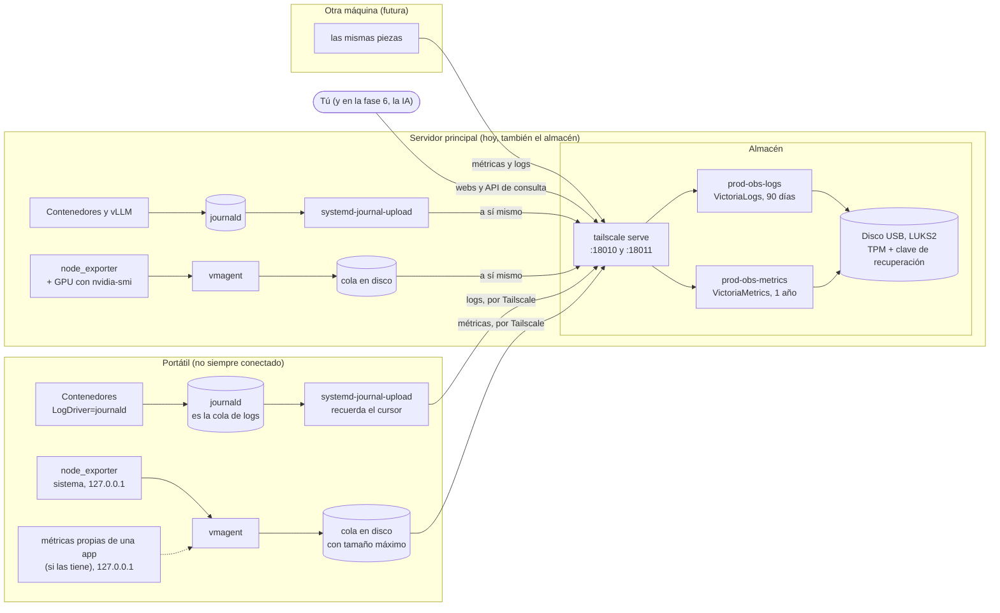
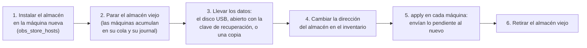

# Observabilidad: cómo funciona

Para entender de un vistazo qué se mide, cómo llega al almacén, dónde se guarda y qué hacer al añadir una aplicación o una máquina. La regla es SPEC 4.8 y el porqué, R62. Las órdenes del día a día irán a [`OPERATIONS.md`](OPERATIONS.md) cuando se implante (fase 3a).

> **Estado:** el almacén, en la fase 3a (rol `obs_store`, playbook `obs-store`). Los agentes de cada máquina llegan en el PR siguiente.

## 1. La idea en cinco líneas

- **Un almacén** con dos bases: VictoriaMetrics (métricas) y VictoriaLogs (logs). Hoy vive en el servidor principal. Puede vivir en cualquier máquina (apartado 6).
- **Cada máquina envía; el almacén nunca va a buscar nada.** Ninguna máquina abre puertos para la observabilidad. Solo el almacén expone su entrada, con `tailscale serve` (R25).
- **Todas las máquinas llevan las mismas piezas**, también la del almacén, que se envía a sí misma. Así, mover el almacén o añadir una máquina es cambiar el inventario, no el diseño.
- **Sin conexión no se pierde nada.** Las métricas esperan en una cola en disco, y los logs, en el propio journal. Al volver la conexión se envía lo pendiente, en bloque.
- **Las aplicaciones casi no hacen nada.** Sus logs ya van al journal (R60). Solo si la aplicación publica sus propias métricas hay que decirlo (apartado 4).

## 2. El recorrido

El almacén no sabe cuántas máquinas hay: acepta lo que le llega. Cada máquina sabe una sola cosa: la dirección del almacén, que es un parámetro del inventario.

## 3. Las piezas

| Pieza | Qué hace | Dónde | Cómo se instala |
| --- | --- | --- | --- |
| journald | Guarda los logs de la máquina y de cada contenedor | Cada máquina | Ya está |
| `systemd-journal-upload` | Envía el journal al almacén y recuerda por dónde iba | Cada máquina | Paquete del sistema (SPEC 7.1) |
| `node_exporter` | Métricas del sistema: CPU, memoria, disco, red… | Cada máquina, solo en `127.0.0.1` | Paquete del sistema |
| Temporizador con `nvidia-smi` | Métricas de la GPU, a través de `node_exporter` | Solo máquinas con GPU NVIDIA | Unidad systemd |
| `vmagent` | Lee las métricas de la máquina y las envía; las guarda en disco si no hay conexión | Cada máquina | Contenedor Quadlet con la red del host (R62) |
| VictoriaMetrics (`<entorno>-obs-metrics`) | Guarda y sirve las métricas. Su web: `/vmui` | Solo en la máquina del almacén, `127.0.0.1:18010` | Contenedor Quadlet |
| VictoriaLogs (`<entorno>-obs-logs`) | Guarda y sirve los logs. Su web: `/select/vmui` | Solo en la máquina del almacén, `127.0.0.1:18011` | Contenedor Quadlet |

Sin métricas por contenedor (`prometheus-podman-exporter`) en la fase 3: no tiene paquete en Ubuntu 24.04. Los arranques, paradas y fallos de cada contenedor están en sus logs. Se decide con las alertas (R62).

## 4. Al añadir una aplicación

Es un paso de [`services/ADD_APP.md`](services/ADD_APP.md) desde la fase 3a. Casi siempre no hay que hacer nada.

1. **Logs: nada.** Con `LogDriver=journald` (R60), que ya exige el CI, sus logs llegan solos. En VictoriaLogs se buscan por la unidad del contenedor (por ejemplo `prod-ff-<instancia>.service`). Solo hay que comprobar en la ficha que la aplicación escribe sus registros en la salida estándar y no en un fichero dentro del contenedor. Si los escribe en un fichero, se configura para que no lo haga y se anota en su página.
2. **¿La aplicación publica sus propias métricas** (una ruta `/metrics` en formato Prometheus)? Se mira en su documentación oficial, al hacer la ficha.
   - **No:** no se hace nada más.
   - **Sí:** la aplicación publica ese puerto en `127.0.0.1`, como su web (`networking.inbound.publish`), y se añade a lo que lee `vmagent` en su máquina. No necesita `egress` ni otra red: `vmagent` tiene la red del host (R62).
3. **Comprobarlo:** tras el `apply`, sus logs y, si las tiene, sus métricas aparecen en el almacén. El paso exacto irá a su página de servicio.

Los datos sensibles de cada aplicación (cuentas, importes, contraseñas en un log) se revisan en la ficha: lo que no debe salir de la máquina se deja fuera.

## 5. Al añadir una máquina

1. Ponerla en el inventario con la dirección del almacén.
2. `./deploy.sh apply` de la observabilidad en esa máquina: instala sus piezas.
3. Comprobar que llegan sus métricas y sus logs.

No se toca el almacén ni las demás máquinas.

## 6. Mover el almacén a otra máquina

Para cuando el servidor principal se cambie o la observabilidad tenga su propia máquina.

Mientras dura, no se pierde nada: cada máquina guarda en su cola y en su journal. Solo hay que no tardar más de lo que aguanta la cola (su tamaño máximo es un parámetro). El journal guarda lo que su propia configuración le deje.

## 7. El disco del almacén

- **LUKS2**, preparado a mano una vez: formatear y cifrar es irreversible y Ansible no lo hace. Ansible comprueba que el directorio está montado y cifrado, y se para si no lo está.
- **Se abre solo al arrancar** con el TPM de la máquina. **En cualquier otra máquina**, con la clave de recuperación, guardada en KeePassXC.
- **Si la máquina arranca sin el disco**, arranca igual. El almacén no arranca; las demás máquinas siguen acumulando.
- **Sin copia de seguridad:** si el disco muere, se pierde la historia. Se acepta (R62).
- **Hasta que llegue el disco** (fase 3a), el almacén usa el disco interno y solo recibe lo del propio servidor. Los logs del portátil, con datos personales, esperan al disco cifrado (3b).

## 8. Instalar el almacén (fase 3a)

En el repo de datos, una vez por entorno:

1. En `inventory/<entorno>/hosts.yml`, el grupo `obs_store_hosts` con la máquina del almacén: el servidor principal en `prod`, la VM en `dev` (como en `inventory.example/`).
2. Solo en `dev`, sin Tailscale: `group_vars/obs_store_hosts.yml` como el de `inventory.example/dev/`. En `prod` no hace falta nada: todo tiene valor por defecto.
3. `./deploy.sh plan obs-store --env dev`, `apply`, y la comprobación de [`OPERATIONS.md`](OPERATIONS.md), apartado 4. Después, lo mismo en `prod` con `--limit` a la máquina del almacén.

No necesita secretos. Pide la contraseña de `sudo`: crea su carpeta y, en `prod`, configura `tailscale serve`.
